# Tarea2.2

## Práctica: instalar tres SGBD

### Características de la máquina
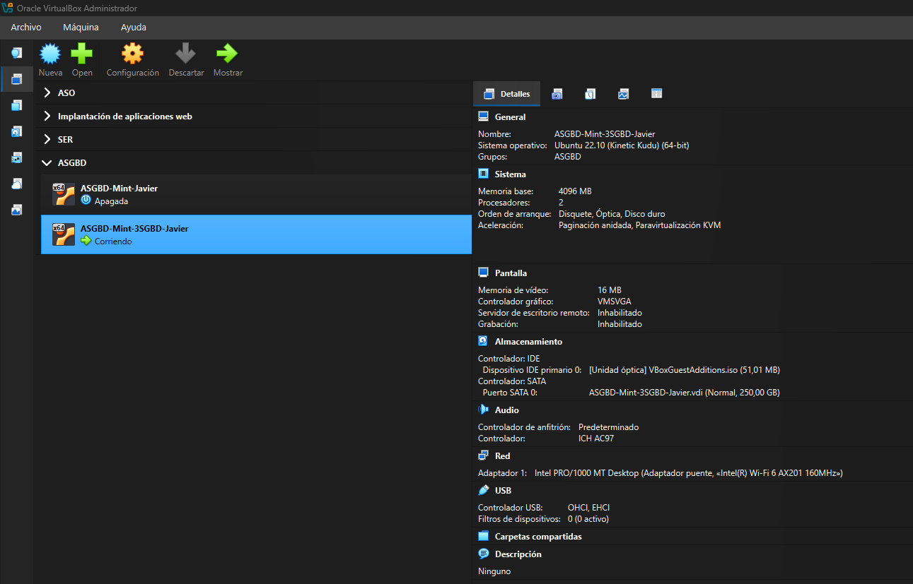

### 1. Desplegar Oracle Database 23ai Free con Podman

#### Primero deberemos instalar Podman y descargar la imagen de Oracle
Para ello utilizaremos los siguientes comando  
`sudo apt update`  
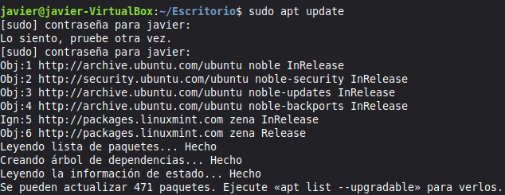  
`sudo apt install podman`  
  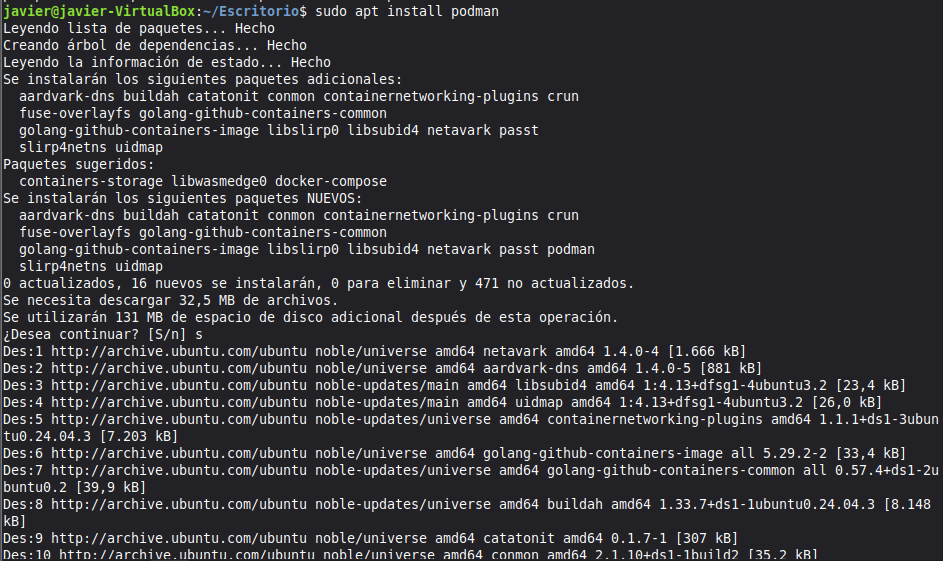  
`sudo podman pull container-registry.oracle.com/database/free:23.5.0.0`  
  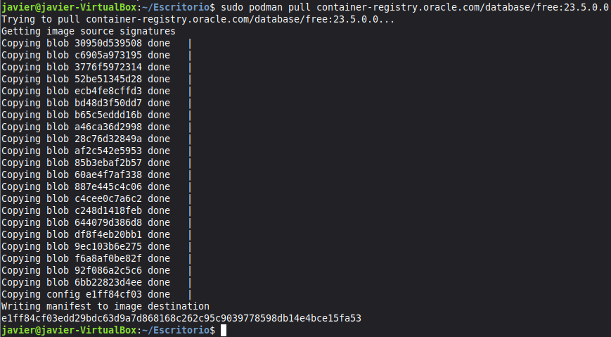  
`sudo podman images`  
    

### Crearemos y comprobaremos el contenedor
Ahora crearemos el contenedor y lo comprobaremos con los siguientes comandos

`sudo podman volume create oracle_23ai_datos`  
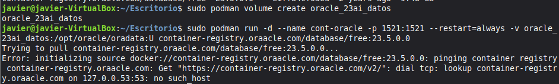  
`sudo podman run -d --name cont-oracle -p 1521:1521 --restart=always -v oracle_23ai_datos:/opt/oracle/oradata:U container-registry.oracle.com/database/free:23.5.0.0`  
`sudo podman ps`  
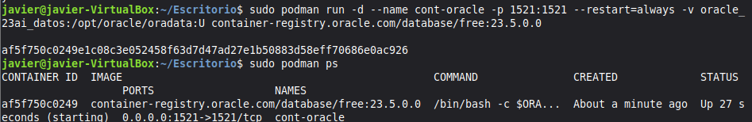  
`sudo podman ps -a`  
`sudo podman logs cont-oracle`  
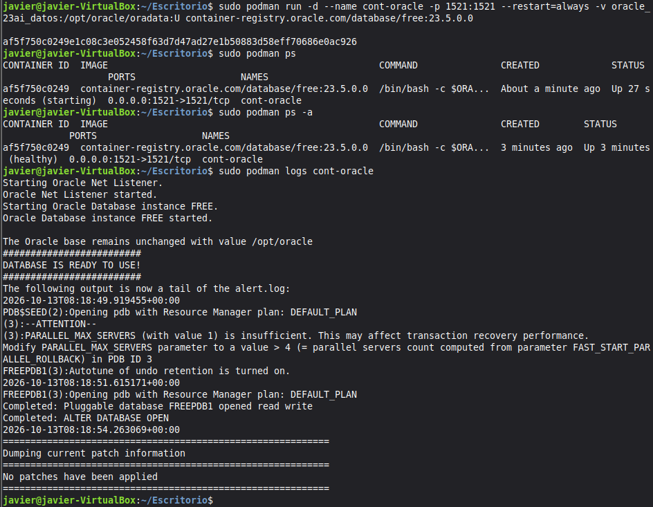  

### Entramos en Oracle y creamos el usuario de trabajo
Para ello ejecutaremos los siguientes comandos en la terminal:  

`sudo podman exec -it cont-oracle/bin/bash`  
`exit`  
`sudo podman exec -it cont-oracle sqlplus / as sysdba`  
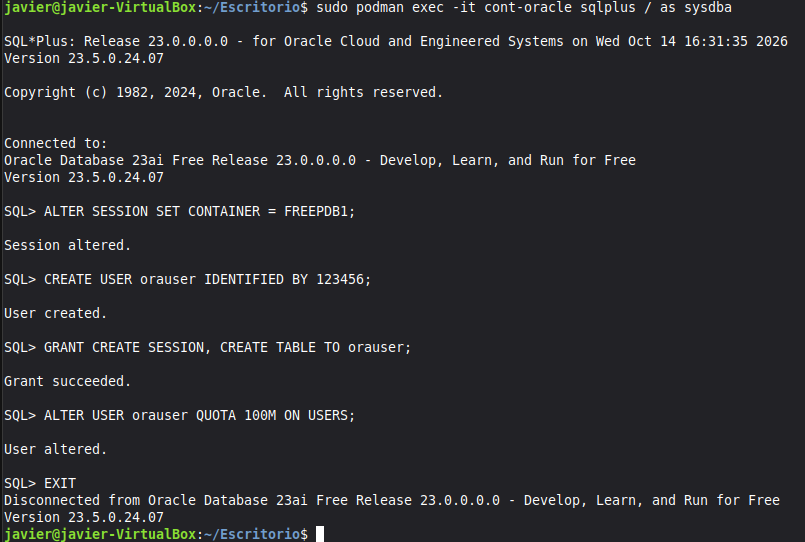

##### Dentro de SQL, comprobaremos la PDB y crearemos el usuario de FREEPDB1:

`SHOW PDBS`  
`ALTER SESSION SET CONTAINER = FREEPDB1:`  
`CREATE USER orauser IDENTIFIED BY "TU_CLAVE";`  
`ALTER USER orauser QUOTA 100M ON USERS;`  
`EXIT`  

- Donde sustituiremos TU_CLAVE por una contraseña propia.

Por último comprobaremos la conexión como usuario de trabajo con el siguiente comando:
`sudo podman exec -it cont-oracle sqlplus orauser@//localhost:1521/FREEPDB1`  

### Desplegar PostgreSQL

##### Primero instalaremos PostgreSQL
Para ello utilizaremos los siguientes comandos  
`sudo apt update`  
`sudo apt install postgresql postgresql-contrib php-psql`  
`sudo systemctl start postgresql`
`sudo systemctl enable postgresql`
`sudo -i -u postgres`
`psql`  

En psql:  
`CREATE DATABASE dbpg;`  
`CREATE USER pguser WHITH PASSWORD TU_CLAVE;`  
`GRANT ALL PRIVILEGES ON DATABASE dbpg TO pguser;`  
`\q`  

Salimos de la sesión del usuario postgres y comprueba la conexión:  
`exit`  
`psql -h localhost -U pguser -d dbpg -W`  

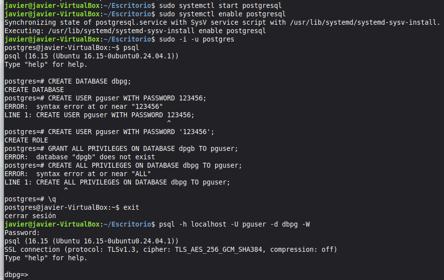  

### Desplegar MariaDB  
`sudo apt update`  
`sudo apt install mariadb-server mariadb-client`  
`sudo systemctl enable --now mariadb`  
`sudo mariadb`  

En el indicador de MariaDB:
`CREATE DATABASE dbm CHARACTER SET utf8mb4 COLLATE utf8mb4_unicode_ci;`  
`CREATE USER 'muser'@'localhost' IDENTIFIED BY 'TU_CLAVE';`  
`GRANT ALL PRIVILEGES ON dbm.* TO 'muser'@'localhost';`  
`FLUSH PRIVILEGES;`  
`EXIT`  

Ahora comprobaremos el acceso local con el siguiente comando:  
`mariadb -u muser -p dbm`  

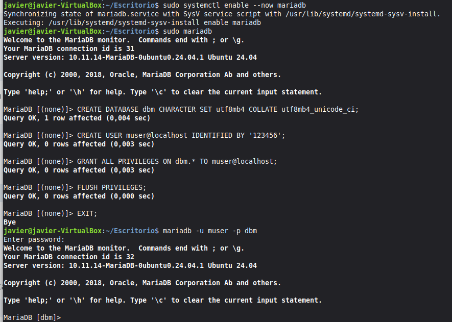  

### Resumen y comprobaciones  

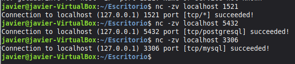  

### Conexiones desde otra máquina  
Primero deberemos comprobar la IP de la máquina  

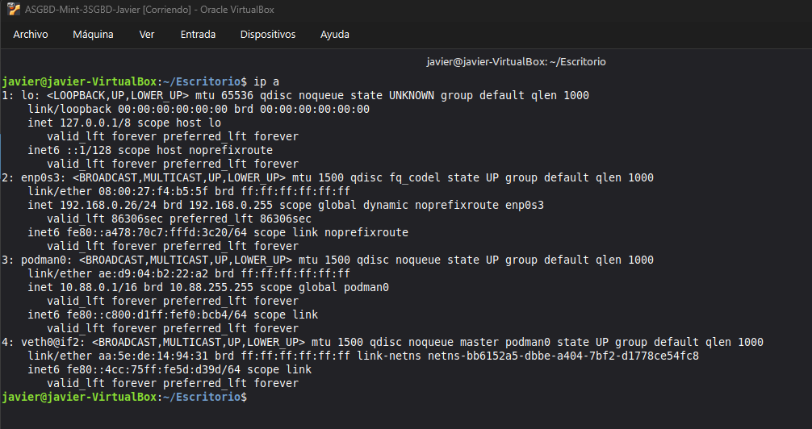  

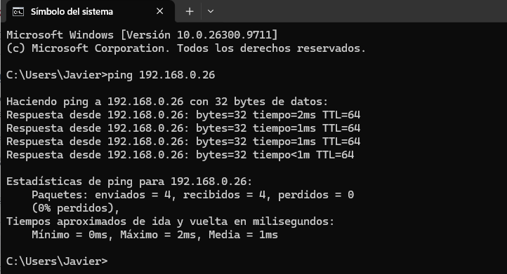  

